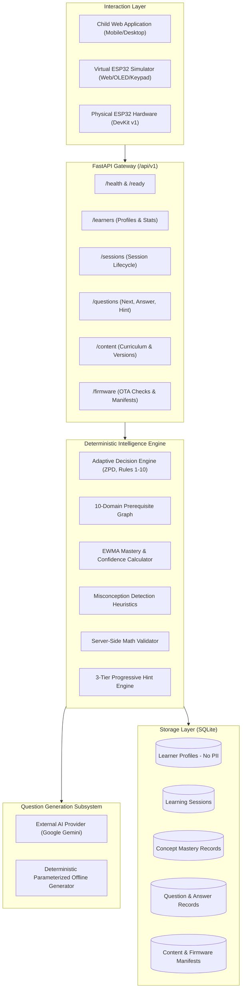

# MathQuest — System Architecture Document

## 1. System Overview

MathQuest is an integrated, low-cost educational toy and software platform designed to teach mathematics to children aged 8–14. Unlike static quiz software, MathQuest employs a **Deterministic Adaptive Learning Engine** running alongside an **AI-Assisted Question Generator** to tailor mathematical concepts to each child's demonstrated mastery.

---

## 2. Component Architecture

### A. Backend & REST API
- **Framework:** FastAPI with Python 3.11 / 3.14.
- **Data Validation:** Pydantic V2 with strict schema enforcement.
- **Database Abstraction:** SQLAlchemy 2.x with explicit transactions and parameterization.
- **Security:** Non-identifiable learner IDs, zero PII, HTTP security headers, CORS protection, rate-limiting.

### B. Core Intelligence Engine
- **Deterministic Decision Making:** Independent of whether an external AI is reachable.
- **Zone of Proximal Development (ZPD):** Balances challenge and frustration by selecting concepts where current mastery is between 0.35 and 0.75.
- **10 Core Rules:**
  1. ZPD-based topic selection
  2. Prerequisite gating (requires >= 0.58 mastery on dependencies)
  3. Continuous difficulty matching (Levels 1–5)
  4. Contextual format selection (multiple-choice vs numeric entry)
  5. Remedial redirection after repeated mistakes (>= 2 incorrect)
  6. Difficulty escalation after sustained success (>= 2 correct)
  7. Scaffolding reduction upon difficulty struggle
  8. Automated hint recommendations
  9. Duplicate avoidance (sliding window of last 15 seen questions)
  10. Hysteresis cooldowns preventing rapid difficulty oscillation

### C. Question Generation & Validation
- **Untrusted AI Principle:** Output from external language models is treated as untrusted.
- **Dual Verification:**
  - Structural validation (JSON fields, required options, correct answer presence).
  - Mathematical verification (independent calculation, division by zero prevention, range checks).
- **Graceful Fallback:** If the external AI times out, errors, or returns unparseable mathematics, the system automatically falls back to the deterministic offline generator without interrupting gameplay.

### D. Physical Hardware & Virtual Simulator
- **Microcontroller:** ESP32 DevKit V1 (30-pin / Dual Core).
- **Display:** 0.96" SSD1306 128x64 OLED via I2C (GPIO 21 SDA, GPIO 22 SCL).
- **Buttons:** 4 active-LOW pushbuttons (UP, DOWN, SELECT, HINT) with hardware debouncing.
- **Feedback:** 3 LEDs (Wi-Fi Blue, Correct Green, Error Red) and Piezo Buzzer (PWM audio).
- **Virtual Simulator:** Interactive browser-based reproduction with simulated screen, buttons, LEDs, and Web Audio synthesis.
