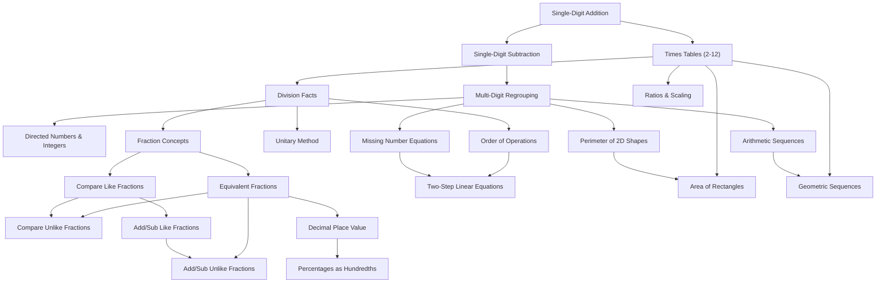

# MathQuest — Mathematics Curriculum & Adaptive Learning Engine

## 1. Pedagogical Foundations

MathQuest is structured around **Vygotsky's Zone of Proximal Development (ZPD)** and cognitive scaffolding. A child learns most effectively when presented with problems that are neither trivial (leading to boredom) nor excessively difficult (leading to frustration and learned helplessness).

---

## 2. The 10 Mathematical Curriculum Domains

| Order | Domain ID | Domain Title | Focus Concepts & Skills |
| :---: | :--- | :--- | :--- |
| **1** | `add_sub` | Addition & Subtraction | Single-digit facts, multi-digit regrouping, negative numbers |
| **2** | `mul_div` | Multiplication & Division | Times tables (2-12), division facts, multi-digit factors, PEMDAS |
| **3** | `fractions_intro` | Fractions & Equivalent Fractions | Numerator/denominator models, visual parts, fraction simplification |
| **4** | `fractions_compare`| Comparing & Ordering Fractions | Like and unlike denominators, cross-multiplication |
| **5** | `fractions_ops` | Fraction Addition & Subtraction | Common denominators, like/unlike combinations |
| **6** | `decimals_percents`| Decimals & Percentages | Place value (tenths/hundredths), decimal addition, percentages |
| **7** | `ratios_proportions`| Ratios & Proportions | Simplification (a:b), unitary method, proportional scaling |
| **8** | `basic_algebra` | Basic Algebra | Missing numbers, one-step equations, two-step balancing |
| **9** | `geometry_measurement`| Geometry & Measurement | 2D perimeter, area of rectangles/triangles, interior angle sums |
| **10**| `patterns_logic` | Number Patterns & Logic | Arithmetic step sequences, multiplicative geometric patterns |

---

## 3. Prerequisite Dependency Graph

MathQuest enforces a strict directed acyclic graph (DAG) of prerequisite skills:



A concept is unlocked only when all its parent prerequisites achieve a mastery score $\ge 0.58$.

---

## 4. Mastery Estimation Formula (EWMA)

Mastery is updated on each submitted answer using an **Exponentially Weighted Moving Average (EWMA)** bounded in $[0.05, 0.98]$:

$$M_{t} = (1 - \alpha) \cdot M_{t-1} + \alpha \cdot P_{t}$$

Where:
- $M_t$: Updated mastery score.
- $M_{t-1}$: Previous mastery score (default initialization $= 0.50$).
- $\alpha$: Smoothing rate ($\alpha = 0.28$).
- $P_t$: Performance score on attempt $t$.

### Performance Score Calculation ($P_t$):
$$P_t = W_{\text{difficulty}} \cdot S_{\text{speed}} - H_{\text{penalty}}$$

1. **Difficulty Weight ($W_{\text{difficulty}}$):**
   - Correct: $W = 0.60 + (\text{difficulty} \times 0.08)$
   - Incorrect: $W = 0.10 + ((\text{difficulty} - 1) \times 0.08)$

2. **Speed Factor ($S_{\text{speed}}$):**
   - Fluent recall (2s – 8s, correct): $1.12$
   - Normal thinking (8s – 20s): $1.00$
   - Slow calculated (> 20s, correct): $0.90$
   - Impulsive guess (< 1.5s, incorrect): $0.75$

3. **Hint Penalty ($H_{\text{penalty}}$):**
   - Each requested hint reduces $P_t$ by $0.12$ (clamped to a maximum deduction of $0.35$).

### Hysteresis & Anti-Oscillation Rules:
- If a learner has attained high mastery ($M_{t-1} > 0.75$) and commits an isolated mistake, $\alpha$ is dynamically halved to $0.15$ to prevent excessive penalty from a single slip.
- Difficulty increases require **2 consecutive correct answers**.
- Difficulty decreases require **2 consecutive incorrect answers**.
- When a learner struggles twice on a concept with prerequisites, the engine halts escalation and initiates a **Remedial Branch** targeting the weakest prerequisite.

---

## 5. Explainable Recommendation Record

For every selected question, the system logs a human-readable explanation of why the question was chosen:

```json
{
  "topic_id": "mul_div",
  "concept_id": "multiplication_facts",
  "difficulty": 3,
  "rationale": "Selected concept 'Times Tables (2 to 12)' with current mastery 0.74 (in Zone of Proximal Development, prerequisites satisfied). Sustained streak of 2 correct answers advanced difficulty to 3."
}
```
