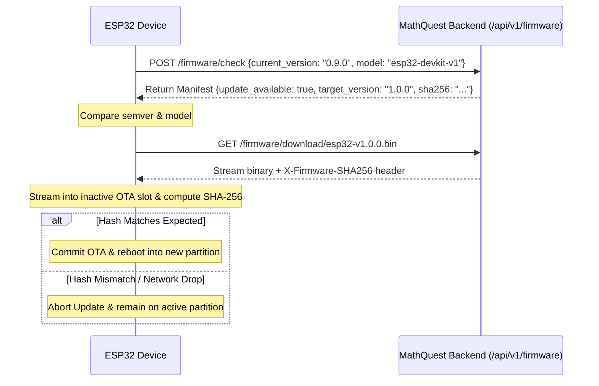

# MathQuest — Over-The-Air (OTA) & Content Update Specification

MathQuest features a two-tiered update architecture:
1. **Tier A — Dynamic Content & Curriculum Updates:** Zero downtime, client-agnostic content updates.
2. **Tier B — ESP32 Firmware OTA Updates:** Dual-partition fail-safe firmware updates.

---

## 1. Tier A: Content & Curriculum Updates

Content updates allow new mathematical question templates, misconceptions, and learning objectives to be deployed without reflashing devices.

- **Endpoint:** `GET /api/v1/content/version`
- **Integrity Verification:** SHA-256 hash computed across all active curriculum domains.
- **Rollback Behavior:** If downloaded curriculum metadata fails SHA-256 verification, clients retain the previous verified cached version.

---

## 2. Tier B: ESP32 Firmware OTA Updates

### Partition Table Layout (`partitions.csv`)
```csv
# Name,   Type, SubType, Offset,  Size, Flags
nvs,      data, nvs,     0x9000,  0x4000,
otadata,  data, ota,     0xd000,  0x2000,
phy_init, data, phy,     0xf000,  0x1000,
ota_0,    app,  ota_0,   0x10000, 0x1E0000,
ota_1,    app,  ota_1,   0x1F0000, 0x1E0000,
spiffs,   data, spiffs,  0x3D0000, 0x30000,
```

- **Dual Application Slots:** `ota_0` and `ota_1` (1.9 MB each).
- **Safe Bootloader Switching:**
  - Firmware is downloaded into the inactive partition.
  - The hash and header are verified.
  - If valid, `otadata` updates the boot pointer to the new partition.
  - If the new firmware crashes or bootloops, the ESP32 bootloader reverts to the previous working slot.

### OTA Verification Flow


---

## 3. Physical Hardware Verification Protocol

Before deploying firmware to physical classroom toys:
1. Compile firmware binary using `pio run -e esp32dev`.
2. Extract binary hash: `Get-FileHash .pio/build/esp32dev/firmware.bin -Algorithm SHA256`.
3. Register the manifest in the backend database.
4. Connect test ESP32 over USB and verify boot output over UART (115200 baud).
5. Trigger update test and monitor serial logs during partition write and restart.
